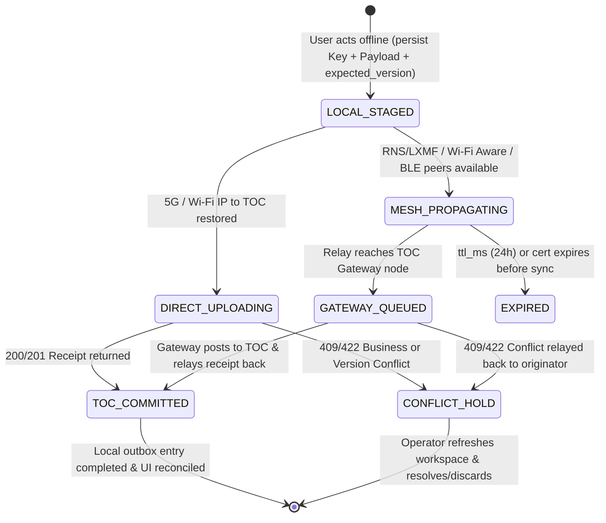

# Protocol X: RNS Communication Engine ↔ TOC Backend Unified Contract (`v1.0`)

**Status:** Normative Parallel-Development Contract (Track A ↔ Track B)  
**Target Branch:** `rns/roadmap-and-contracts`  
**Contract Version:** `protocol-x.rns.contract/v1`  
**Companion Roadmap:** [docs/RNS-ROADMAP.md](RNS-ROADMAP.md) (`Epic #8`, `RNS-01`..`RNS-13`)  

---

## 1. Purpose, Scope & Track Ownership

This document defines the shared wire, identity, offline-reconciliation, ontology-sync, and TAK-projection contract between **Track A (Communication Engine)** and **Track B (TOC Backend)** so both tracks can build, test, and integrate in parallel without breaking existing Protocol X behavior.

- **Track A (Communication Engine — `RNS-01`..`RNS-10`, `RNS-12`, `RNS-13`):**
  - Rust RNS/LXMF Core + UniFFI bindings (`rust/protocolx-rns/`).
  - Android Communication Interface decoupling (`RNS-02` in `android/app/src/main/java/com/mandonothing/ops/`).
  - RNS Runtime / LXMF store-and-forward, Wi-Fi Aware adapter (`NearbyRadios.Aware`), BLE L2CAP fallback (`NearbyRadios.Ble`), Private Network / Identity, Multi-hop Routing, Network Manager auto-failover (`5G/HTTPS ↔ Wi-Fi Aware/BLE ↔ RNS/LXMF`), and multi-hop PTT.
- **Track B (TOC Backend — `RNS-11` & Backend Extensions in `app/`):**
  - Ontology Runtime (`app/bindings.py`, `ontologies/golf.json`, `ontologies/conference.json`).
  - Action & Machinery Runtime (`app/main.py`, `app/store.py`, `app/field_tasks.py`, `app/arrival_desk.py`, `app/qrf.py`).
  - AI Dispatch & Rules (`app/ptt_agent.py`, `app/flight_dispatch.py`, `app/pickup_scenario.py`, `app/transcribe_ptt.py`).
  - Projection Engine (`project_task`, `ArrivalDesk.project`, `WorkspaceChanges`, `ChannelWakeups`).
  - TAK Gateway (`app/tak.py`, `app/tak_ptt.py`).

### 1.1 Grounded Baseline Invariants (Must Not Regress)

Every requirement in this contract preserves the verified invariants of the current codebase:

1. **Ontology-agnostic projection:** Frontends and transport layers never branch on domain types (`TransferLeg`/`Vehicle` in `ontologies/golf.json`, `Session`/`Room` in `ontologies/conference.json`). They pass opaque `ObjectRef` (`{ontology_id, object_type, id}` in `app/models.py`) and consume `project_task` / `allowed_actions` (`app/bindings.py`).
2. **Evidence vs. State Mutation separation:** Text messages, PTT transcripts, sensor/flight observations, and AI proposals (`proposals` table, `engine` in `{"deterministic_demo", "flight_dispatch", "ptt_incident"}`) **never** directly mutate Ontology object state (`objects.data` / `objects.version`). Only authorized `ActionInput` (`POST /api/events/{event_id}/actions`) or `StageInput` (`POST /api/events/{event_id}/arrival-plans/{plan_id}/stages`) transitions state and writes `receipts`.
3. **Zero duplicate side effects:** Backend persistence enforces uniqueness and payload-fingerprint checks (`receipts` `UNIQUE(event_id, idempotency_key)` in `app/store.py`, `field_photos.id`, `field_channel_attachments` PK, `tak_deliveries` PK).
4. **Offline PTT boundary:** Offline recorded voice is persisted as a voice note / message attachment and **must not** auto-replay as live real-time PTT audio upon reconnect (aligned with `docs/KICKOFF-PLAN.md` and `NearbyLiveVoice`).

---

## 2. System Topology & Integration Boundary

```mermaid
flowchart LR
    subgraph Device["Field Android Device (Track A Client)"]
        UI["UI / Domain State<br/>(MainActivity, FieldOfflineStore)"]
        CI["RNS-02 Comm Interface<br/>(Transport Gateway / Router)"]
        NM["RNS-08 Network Manager<br/>(5G/HTTPS | Wi-Fi Aware | BLE | RNS)"]
        RUST["RNS-01/03 Rust Core (UniFFI)<br/>RNS Identity, LXMF, Multi-hop"]
        UI --> CI --> NM
        NM -->|"Direct HTTPS/WSS"| TOC_HTTP
        NM -->|"Local Mesh / Multi-hop"| RUST
    end

    subgraph Edge["Peer Relay / RNS Gateway Node"]
        RELAY["RNS Transport Node<br/>(1..5 hops, Wi-Fi Aware / BLE / IP)"]
        GW["RNS-11 TOC/RNS Gateway<br/>(LXMF <-> TOC HTTP Bridge)"]
        RUST <-->|"Private RNS / LXMF"| RELAY <-->|"When uplink available"| GW
    end

    subgraph TOC["TOC Backend (Track B - app/)"]
        TOC_HTTP["FastAPI Ingress<br/>(app/main.py, field_*.py, qrf.py)"]
        MACH["Action & Idempotency Runtime<br/>(app/store.py, bindings.py)"]
        AI["AI / Rules Pipeline<br/>(ptt_agent.py, flight_dispatch.py)"]
        PROJ["Projection & Change Feeds<br/>(WorkspaceChanges, ChannelWakeups)"]
        TAK["TAK Gateway<br/>(app/tak.py, tak_ptt.py)"]
        TOC_HTTP --> MACH --> PROJ
        MACH --> AI --> PROJ
        MACH --> TAK
    end

    GW -->|"Authenticated HTTP + Envelope"| TOC_HTTP
    TAK <-->|"TLS CoT + Marti HTTPS Readback"| OTS["OpenTAKServer / ATAK"]
```



Track A operates over two uplink paths to Track B:
1. **Direct IP Path:** Device reaches TOC FastAPI directly via HTTPS (`OpsClient`) and LiveKit WSS (`VoiceChannel`, `VideoChannel`).
2. **RNS Store-and-Forward Gateway Path:** When direct IP is unavailable, the device sends Canonical Envelopes (`Section 3`) over RNS/LXMF (`Wi-Fi Aware`, `BLE`, or private IP mesh). Any peer or dedicated **TOC RNS Gateway (`RNS-11`)** with IP connectivity forwards the signed, idempotent envelope to Track B's ingress endpoint without altering the originator's signature, `envelope_id`, or `idempotency_key`.

---

## 3. Unified Envelope Schema (Wire & Backend Alignment)

All Track A ↔ Track B cross-transport payloads use the canonical envelope `protocol-x.rns.envelope/v1`.  
- **On the wire (RNS/LXMF / Wi-Fi Aware / BLE):** Serialized as canonical JSON (matching `app/store.py:dump` — UTF-8, sorted keys, no extra whitespace) or deterministic MessagePack/CBOR mapping 1:1 to the JSON schema below, wrapped in transport framing/encryption.
- **At TOC Backend:** Ingress validates schema, verifies sender authority/signature (for relayed/mesh envelopes), maps to existing domain tables (`objects`, `messages`, `receipts`, `field_photos`, `field_channel_attachments`, `tak_deliveries`, `field_task_delivery`), and echoes the backend canonical record.

### 3.1 Common Outer Envelope (`EnvelopeV1` / Kotlin `CommEnvelope`)

At the Android `RNS-02` Communication Interface boundary, this schema is represented by the `CommEnvelope` model and serialized onto the wire as `protocol-x.rns.envelope/v1`.

| Field | Type | Required | Constraints / Alignment |
| :--- | :--- | :--- | :--- |
| `schema` | `string` | Yes | Fixed `"protocol-x.rns.envelope/v1"` |
| `envelope_id` | `string` | Yes | UUIDv4 (lowercase canonical) or deterministic UUIDv3/v5 for derived receipts (matches `NearbyMessages.kt:isMessageId`) |
| `kind` | `enum` | Yes | `"event" \| "task" \| "message" \| "attachment" \| "location" \| "delivery_receipt"` |
| `event_id` | `string` | Yes | Activity scope ID (e.g. `"golf-demo"`, `"golf-hkg-arrivals-demo"`, `"conference-demo"`) |
| `channel_id` | `string \| null` | Cond. | Required for channel-scoped comms (`"group-<32hex>"` or `"direct-<32hex>"` in `app/field.py`); `null` for event-global task/TAK ops |
| `actor` | `string` | Yes | Originator identity (`"person-<32hex>"`, `"demo-staff"`, `"demo-dispatcher"`) |
| `device_id` | `string` | Yes | SHA-256 `token_hash` prefix or `NearbyIdentity.sender` (`[0-9a-f]{32}` / RNS `Identity` hash) |
| `created_at` | `string` | Yes | UTC ISO 8601 (`YYYY-MM-DDTHH:MM:SS.sssZ` or `+00:00`, per `docs/API-CONTRACT.md`) |
| `ttl_ms` | `integer` | Yes | Default `86_400_000` (24h, matching `NEARBY_SEND_WINDOW` in `NearbyMessages.kt`); bounded by credential `expires` (`12h` max offline lease for nearby auth) |
| `priority` | `integer` | Yes | `0` (bulk attachment), `1` (ordinary message/telemetry), `2` (task action/mutation), `3` (control/receipt & `assistance` emergency — maps to `NearbyMessage.priority`) |
| `idempotency_key` | `string` | Yes | Deterministic key per Section 4 (`8..128` chars, aligns with `ActionInput.idempotency_key`) |
| `fingerprint` | `string` | Yes | Lowercase hex SHA-256 over canonical payload + scope (Section 4.1) |
| `trace` | `object` | Yes | `{ "hop_count": int, "origin_radio": "HTTPS\|WIFI_AWARE\|BLE\|RNS_IP\|LIVEKIT", "rns_packet_hash": string\|null, "gateway_actor": string\|null }` |
| `auth` | `object` | Yes | `{ "key_id": string, "public_key": string, "certificate": string, "signature": string }` (Section 6) |
| `payload` | `object` | Yes | Kind-specific object defined in Sections 3.2–3.7 |

### 3.2 Payload Kind: `event`

Represents domain/lifecycle observations, PTT lifecycle signals, flight notices, and sync wakeups.

```json
{
  "event_kind": "ptt_mic_lifecycle | flight_notice | workspace_invalidated | channel_invalidated | ptt_incident | arrival_history",
  "source": "livekit | hkia | rns_ptt | toc_runtime",
  "subject_ref": { "ontology_id": "golf.v1", "object_type": "TransferLeg", "id": "transfer-001" },
  "revision": "string | null",
  "cursor": "string | null",
  "attributes": {}
}
```

- **Backend Alignment:**
  - `ptt_mic_lifecycle`: maps to `app/tak_ptt.py` (`MICROPHONE_EVENTS`: `track_published` -> `"started"`, `track_unpublished` -> `"ended"`, `session_id`, `track_sid`, `room`, `livekit_event_id`, `observed_at`).
  - `flight_notice`: maps to `app/arrival_desk.py` `arrival_flight_notices` (`seq`, `event_id`, `task_id`, `flight`, `kind` in `{"delay","landed","at_gate"}`, `source_at`).
  - `workspace_invalidated`: maps to `app/workspace_changes.py` (`{generation}.{global_revision}.{event_revision}`).
  - `channel_invalidated`: maps to `app/channel_feed.py` (`cursor = "{ops}:{voice}"`).
  - `ptt_incident`: maps to `app/ptt_agent.py:record_incident` (`kind` in `{"vehicle","handoff","delay","assistance"}`, `voice_channel_id`, `voice_track_sid`, `flight_mentions`, `place_mentions`).

### 3.3 Payload Kind: `task`

Represents task dispatch, task state mutations (`ActionInput`), and arrival stage confirmations (`StageInput`). **Carries opaque `ObjectRef` + `expected_version`; never embeds ontology-specific logic in Track A.**

```json
{
  "op": "dispatch | dispatch_arrival | action | confirm_arrival_stage",
  "target_ref": { "ontology_id": "golf.v1", "object_type": "TransferLeg", "id": "transfer-001" },
  "expected_version": 1,
  "action_type": "acknowledge | replace_resource | confirm_progress | reschedule_pickup | decline_response | dispatch_task | dispatch_arrival_task | confirm_stage",
  "parameters": {
    "replacement_ref": null,
    "progress_index": 0,
    "pickup_at": null,
    "stage": "met | boarded | hotel_handoff | checked_in",
    "person_id": null,
    "title": null,
    "location": null,
    "contact": null,
    "due": null
  },
  "proposal_id": null,
  "client_seq": 1,
  "local_acted_at": "2026-11-26T05:00:00Z"
}
```

- **Backend Alignment:**
  - `op = "action"` -> `POST /api/events/{event_id}/actions` (`ActionInput` in `app/models.py`).
  - `op = "confirm_arrival_stage"` -> `POST /api/events/{event_id}/arrival-plans/{plan_id}/stages` (`StageInput` in `app/arrival_desk.py`).
  - `op = "dispatch"` -> `POST /api/field/events/{event_id}/dispatch` (`DispatchInput` in `app/field_tasks.py`).
  - `op = "dispatch_arrival"` -> `POST /api/field/events/{event_id}/dispatch/arrival` (`ArrivalDispatchInput` in `app/field_tasks.py`).
  - `client_seq` supports ordered offline checkpoint replay (`FieldOfflineStore.Queued` in `FieldOfflineStore.kt`).

### 3.4 Payload Kind: `message`

Unifies channel chat, private E2EE messages, task reports, QRF assistance/exception reports, dispatcher instructions, and archived voice notes.

```json
{
  "scope": "channel_group | channel_direct | task_report | qrf_assistance | qrf_reviewed | dispatch_instruction | voice_note",
  "text": "string",
  "subject_ref": { "ontology_id": "golf.v1", "object_type": "TransferLeg", "id": "transfer-001" },
  "recipient": "person-... | null",
  "sealed_payload": "base64 | null",
  "assistance": false,
  "confirmation_required": true,
  "incident_id": "string | null",
  "task_version": 1,
  "voice_ref": {
    "track_sid": "string | null",
    "duration_ms": 0,
    "attachment_id": "uuid | null",
    "transcript_partial": false
  }
}
```

- **Wire & Backend Alignment:**
  - `scope = "task_report"` -> `POST /api/events/{event_id}/messages` (`MessageInput`, `source: "text"`).
  - `scope = "qrf_assistance"` -> `POST /api/events/{event_id}/qrf/assistance` (`HelpInput`, `source: "qrf_exception"`, `request_kind: "assistance"`) and `NearbyMessages.send(..., assistance = true)`.
  - `scope = "qrf_reviewed"` -> `POST /api/events/{event_id}/qrf/reports` (`ReviewedReportInput`, `source: "qrf_exception"`).
  - `scope = "dispatch_instruction"` -> `POST /api/field/events/{event_id}/channels/{channel_id}/incidents/{incident_id}/dispatch` (`DispatchInstruction`, `source: "dispatch_instruction"`, `recipients`, `task_version`).
  - `scope = "channel_group" | "channel_direct"` -> Maps to `NearbyMessage` (`NearbyMessages.kt`): when `sealed_payload` is present (`NearbyPrivate.seal`), `text` MUST be `"加密定向消息"` (`PRIVATE_PLACEHOLDER`) and `recipient` MUST be set (`actorPattern`).
  - **MTU / Limit Alignment:**
    - Over legacy `NearbyRadios` frame (`NEARBY_FRAME_LIMIT = 82_000`): `text <= 200` chars (`NEARBY_TEXT_LIMIT`), inline audio `<= 48_000` bytes (`NEARBY_AUDIO_LIMIT`), `sealed_payload <= 44_000` chars (`NEARBY_PRIVATE_ENVELOPE_LIMIT`; `<= 3_200` chars over BLE `PRIVATE_BLE_LIMIT`).
    - Over RNS/LXMF: small messages (`<= 319` bytes payload) use LXMF opportunistic single-packet delivery; larger payloads (`<= 48 KB` voice note or `<= 4000` chars `MessageInput.text`) use LXMF direct link or Resource transfer; heavy media uses `attachment` (Section 3.5).

### 3.5 Payload Kind: `attachment`

Decouples metadata/manifest announcement from bulk binary transfer so small control/task packets never stall behind video/photo payloads.

```json
{
  "attachment_id": "uuid-v4",
  "target_kind": "task_photo | channel_photo | channel_video | voice_note | arrival_player_photo",
  "task_id": "string | null",
  "media_type": "image/jpeg | video/mp4 | audio/mp4 | audio/wav | image/png",
  "caption": "string",
  "total_bytes": 123456,
  "poster_bytes": 12345,
  "duration_ms": 15000,
  "sha256_content": "hex64",
  "sha256_combined": "poster_bytes:hex64",
  "transfer": {
    "mode": "http_put | http_post_b64 | lxmf_resource | rns_chunked",
    "chunk_size": 16384,
    "chunk_count": 8,
    "poster_inline_b64": "string | null"
  }
}
```

- **Backend & Android Alignment:**
  - `task_photo`: maps to `POST /api/field/events/{event_id}/tasks/{task_id}/photos` (`PhotoInput` in `app/field_tasks.py`, `PhotoOutbox.Entry` in `PhotoOutbox.kt`): JPEG only, `<= 1_000_000` bytes, `sha256_content` matches `field_photos.fingerprint` (`digest(body.jpeg)` for HTTP Base64 or canonical SHA-256 at gateway).
  - `channel_photo`: maps to `PUT /api/field/events/{event_id}/channels/{channel_id}/attachments/{attachment_id}` (`app/channel_attachments.py`, `ChannelAttachmentFiles` in `ChannelAttachments.kt`): `image/jpeg`, `<= 750 * 1024` bytes (`PHOTO_BYTES`), max dimension `1600px`, poster JPEG `<= 48 * 1024` bytes (`POSTER_BYTES`, max `480px`).
  - `channel_video`: `video/mp4` (`ftyp` + `moov` + `mdat`, non-fragmented, no `moof`, `mp4_duration` `1..30_000` ms `VIDEO_MS`), `<= 16 * 1024 * 1024` bytes (`VIDEO_BYTES`), poster JPEG `<= 48 * 1024` bytes, `caption <= 500` chars.
  - `sha256_combined`: MUST match `f"{poster_bytes}:{hashlib.sha256(poster + content).hexdigest()}"` (`app/channel_attachments.py:203`).

### 3.6 Payload Kind: `location`

Standardizes field GPS/position reports, activity reference points, and TAK markers.

```json
{
  "location_kind": "point_marker | peer_pli | reference_point",
  "title": "string",
  "latitude": 22.308047,
  "longitude": 113.918480,
  "hae": null,
  "ce": null,
  "le": null,
  "source": "gps | user_pin | activity_reference",
  "observed_at": "2026-11-26T05:00:00Z",
  "valid_until": "2026-11-26T05:30:00Z",
  "subject_ref": null,
  "cot_type": "b-m-p-s-m | a-f-G-U-C"
}
```

- **Backend & TAK Alignment:**
  - `point_marker`: maps directly to `SharePoint` (`POST /api/events/{event_id}/tak/points` in `app/tak.py`: `request_id`, `title` 1..80 chars without `INVALID_XML`, `latitude` `[-90, 90]`, `longitude` `[-180, 180]`, `MARKER_TYPE = "b-m-p-s-m"`).
  - Unset elevation/error fields map to `NO_POSITION = 9999999` (`app/tak.py:25`) in CoT XML.
  - `reference_point`: aligns with `TakSettings.report_point` (`OPS_TAK_REPORT_LATITUDE`, `OPS_TAK_REPORT_LONGITUDE`, nonzero) and `<precisionlocation geolocationsrc="activity-reference"/>`.
  - **Fact Boundary (`docs/KICKOFF-PLAN.md`):** A `location` envelope is an `Observation` only; entering a geofence never automatically completes `ConfirmHotelHandoff` or `ConfirmAirportMeet`.

### 3.7 Payload Kind: `delivery_receipt`

Unifies mesh-level delivery/read proofs and TOC/TAK server confirmations.

```json
{
  "receipt_kind": "mesh_delivered | mesh_read | task_delivered | instruction_received | qrf_acknowledged | action_committed | tak_readback",
  "target_envelope_id": "string",
  "target_message_id": "string | null",
  "target_ref": null,
  "via_radio": "HTTPS | WIFI | BLE | RNS_IP | LIVEKIT | TAK_COT",
  "status": "delivered | read | committed | awaiting_readback | retryable | received | conflict | expired",
  "server_receipt_id": "string | null",
  "object_version": 2,
  "cot_uid": "string | null",
  "detail": {}
}
```

- **Backend & Android Alignment:**
  - `mesh_delivered`: maps to `NearbyMessage.receiptFor` (`acknowledgePrivate`, `receipt_via` in `NearbyMessages.kt`).
  - `mesh_read`: maps to `NearbyMessage.confirmationFor` (`markRead` / `readReceipts` in `NearbyMessages.kt`).
  - `task_delivered`: maps to `POST /api/field/events/{event_id}/received` (`DeliveryInput`, `field_task_delivery` table in `app/field_tasks.py`).
  - `instruction_received`: maps to `POST /api/field/events/{event_id}/dispatch/{message_id}/receive` (`receive_dispatch_instruction` in `app/field_media.py`).
  - `qrf_acknowledged`: maps to `POST /api/events/{event_id}/qrf/reports/{report_id}/acknowledge` (`ack_qrf_exception` in `app/qrf.py`).
  - `action_committed`: maps to `receipts` record returned by `POST /api/events/{event_id}/actions` (`app/main.py`).
  - `tak_readback`: maps to `tak_deliveries` status (`awaiting_readback | retryable | received`, `cot_uid`, `received_at` in `app/tak.py`).

### 3.8 Live PTT Audio Packets (Latency-Critical Exception)

Real-time PTT streaming over Wi-Fi Aware / RNS (`RNS-10`) does **not** use the store-and-forward `EnvelopeV1` wrapper per 80 ms frame; instead, it preserves the lightweight `NearbyLivePacket` contract (`NearbyLiveVoice.kt`, `NearbyVoiceAuthentication.kt`) or RNS audio stream frames:
- `sender` (32-hex key fingerprint), `burst` (UUIDv4), `sequence` (`0..MAX_SEQUENCE`), `at` (epoch ms, freshness window `-1000ms..+500ms` / auth verify `±2500ms`), `audio` (G.711 μ-law 8 kHz mono 80 ms = 640 bytes Base64, or Opus over RNS link), `end` (boolean), `key`, `certificate`, `signature` (ECDSA SHA-256 over `"protocol-x-nearby-live-voice-v1"`).
- End-of-burst recording (`encodeVoiceNote` AAC-LC or `nearbyFallbackWav` in `NearbyLiveVoice.kt`) is emitted as a `message` (`scope = "voice_note"`) or `attachment` envelope (`Section 3.4`/`3.5`) for durable store-and-forward.

---

## 4. Deterministic Idempotency Keys & Deduplication Contract

**Goal:** Guarantee **0 duplicate business actions** across simultaneous or staggered failovers between 5G/HTTPS, Wi-Fi Aware, BLE L2CAP, and RNS/LXMF multi-hop relays.

### 4.1 Canonical Serialization & Fingerprint Rules

1. **Canonical JSON (`dump`):** Matches `app/store.py:dump`:
   `json.dumps(value, ensure_ascii=False, sort_keys=True, separators=(",", ":"))` encoded as UTF-8.
2. **Fingerprint:** Lowercase 64-char hex SHA-256 of the canonical material defined per operation in Section 4.2.
3. **Rule of Immutability:** Once a client (Android `FieldOfflineStore`, `PhotoOutbox`, `ChannelAttachmentFiles`, `NearbyMessages`, or Web UI) generates an `envelope_id` / `request_id` / `idempotency_key` for an intent, **that key MUST be persisted before transmission** and **reused verbatim across all retries and radio failovers**. A different payload under the same key MUST fail with `409 Conflict`.

### 4.2 Normative Idempotency Key Table (Aligned with Existing Backend)

| Operation | Endpoint / Transport | `idempotency_key` / Record PK | `fingerprint` Material | Conflict Behavior | Source File |
| :--- | :--- | :--- | :--- | :--- | :--- |
| Task Action (`acknowledge`, `replace_resource`, `confirm_progress`, `reschedule_pickup`, `decline_response`) | `POST /api/events/{event_id}/actions` | Client UUIDv4 in `ActionInput.idempotency_key` (`receipts` `UNIQUE(event_id, idempotency_key)`) | `sha256(dump({"request": action_request_excl_none, "identity": {"actor": actor, "role": role}}))` | Same key + same fingerprint -> return stored `receipt` (`200`); mismatch -> `409` | `app/main.py` |
| Text Report / Message | `POST /api/events/{event_id}/messages` | Header `Idempotency-Key` (UUIDv4) -> `id = "msg-" + sha256(dump([event_id, actor, key]))` | `(text, subject_ref)` equality check | Match -> return stored `message` (`201`/`200`); mismatch -> `409` | `app/main.py` |
| Rule Proposal | `POST /api/events/{event_id}/proposals` | `UNIQUE(event_id, message_id)` in `proposals` | `message_id` | Existing -> return stored `proposal` | `app/main.py` |
| Field Dispatch | `POST /api/field/events/{event_id}/dispatch` | `"field-dispatch:" + str(request_id)` in `receipts` | `sha256(dump([event_id, actor, body]))` | Match -> return stored `receipt`; mismatch -> `409` | `app/field_tasks.py` |
| Arrival Dispatch | `POST /api/field/events/{event_id}/dispatch/arrival` | `"field-arrival-dispatch:" + str(request_id)` in `receipts` | `sha256(dump([event_id, actor, body]))` | Match -> return stored `receipt`; mismatch -> `409` | `app/field_tasks.py` |
| Task Delivery Ack | `POST /api/field/events/{event_id}/received` | PK `(event_id, task_id, person_id)` in `field_task_delivery` | `INSERT OR IGNORE` | Idempotent return `{received_at}` | `app/field_tasks.py` |
| Task Photo Upload | `POST /api/field/events/{event_id}/tasks/{task_id}/photos` | `PhotoInput.id` (UUIDv4) as `field_photos.id` | `sha256(jpeg_b64)` + `(event_id, task_id, actor)` | Match -> return summary; mismatch -> `409` | `app/field_tasks.py` |
| Channel Attachment | `PUT /api/field/events/{event_id}/channels/{channel_id}/attachments/{attachment_id}` | PK `(event_id, channel_id, attachment_id)` | `f"{poster_bytes}:{sha256(poster + content)}"` + `(actor, media_type, caption)` | Match -> return item (`200`); mismatch -> `409` | `app/channel_attachments.py` |
| QRF Assistance Request | `POST /api/events/{event_id}/qrf/assistance` | `"assist-" + str(request_id)` as `messages.id` | `(actor, subject_ref, text)` | Match -> return stored `message`; mismatch -> `409` | `app/qrf.py` |
| QRF Reviewed Report | `POST /api/events/{event_id}/qrf/reports` | `"qrf-reviewed-" + str(request_id)` as `messages.id` | `(actor, text, subject_ref)` | Match -> return stored `message`; mismatch -> `409` | `app/qrf.py` |
| QRF Draft Confirm | `POST /api/events/{event_id}/qrf/drafts/{draft_id}/confirm` | `"qrf-" + str(draft_id)` as `messages.id` | `text` equality | Match -> return stored `message`; mismatch -> `409` | `app/qrf.py` |
| QRF Dispatcher Ack | `POST /api/events/{event_id}/qrf/reports/{report_id}/acknowledge` | `"qrf-ack:" + report_id` in `receipts` | `report_id` | Idempotent return stored `receipt` | `app/qrf.py` |
| PTT Incident Message | `ptt_agent.record_incident` | `"ptt-" + sha256(dump([channel_id, track_sid]))[:32]` | `messages.id` PK | Skip insert if exists | `app/ptt_agent.py` |
| Dispatch Instruction | `POST .../incidents/{incident_id}/dispatch` | `"instruction-" + str(request_id)` as `messages.id` | `(actor, incident_id, text, task_version)` | Match -> return stored `message`; mismatch -> `409` | `app/field_media.py` |
| Instruction Receive Ack | `POST .../dispatch/{message_id}/receive` | `"dispatch-receive:" + message_id + ":" + actor` in `receipts` | `message_id` | Idempotent return stored `receipt` | `app/field_media.py` |
| Flight Dispatch Proposal | `flight_dispatch.reconcile` | `"flight-proposal-" + sha256(dump([event_id, ref, evidence, source_time, task_version, action, params]))[:32]` | `ON CONFLICT DO NOTHING` | Idempotent skip | `app/flight_dispatch.py` |
| TAK Report / Point / PTT | `tak.record_delivery` | PK `(event_id, kind, operation_id)` in `tak_deliveries` | `sha256(dump([config.destination(), content]))` | `received` -> return status (`200`); `awaiting_readback` -> readback only (`202`); `retryable` -> resend (`503`); mismatch -> `409` | `app/tak.py`, `app/tak_ptt.py` |
| Nearby Mesh Read / Receipt | `NearbyMessages.acknowledge` | `UUID.nameUUIDFromBytes("protocol-x-nearby-{confirm\|receipt}\|{serviceName}\|{id}\|{actor}")` | Deterministic UUIDv3 + `NearbyJournal.tombstones` | Duplicate dropped in `NearbyMessages.receive` | `NearbyMessages.kt` |
| **NEW (RNS-09/11): Arrival Stage Confirm** | `POST /api/events/{event_id}/arrival-plans/{plan_id}/stages` | Extend `StageInput` with optional `idempotency_key: UUID4` (required for RNS/offline replay) | `sha256(dump({"event_id": event_id, "plan_id": plan_id, "stage": stage, "expected_version": expected_version, "actor": actor}))` | Same key + fingerprint -> return cached stage receipt; mismatch -> `409` | `app/arrival_desk.py` (extension) |
| **NEW (RNS-11): Mesh Envelope Bridge** | `POST /api/rns/v1/envelopes` (internal/gateway ingress) | `(event_id, envelope_id)` in `rns_envelope_dedup` + delegates to operation's native `idempotency_key` | `envelope.fingerprint` | Duplicate `envelope_id` with identical `fingerprint` -> `200` cached outcome; mismatch -> `409` | Track B `RNS-11` |

### 4.3 Three-Tier Deduplication Pipeline Across Failovers

1. **Tier 1 — RNS/LXMF Wire Layer (Track A Rust Core):**
   - Deduplicates identical RNS packet hashes and LXMF message hashes (`LXMF.message_hash`) within the router's sliding window so multi-hop flooding/gossip loops terminate immediately.
2. **Tier 2 — Device & Relay Journal Layer (Track A Kotlin / SQLite):**
   - Preserves `NearbyJournal` `entries` + `tombstones` (`MAX_TOMBSTONES = 1_024`, 24h window in `NearbyMessages.kt`) and extends persistence to an encrypted local SQLite outbox/inbox table keyed by `(event_id, envelope_id)`.
   - When `NetworkManager` (`RNS-08`) fails over mid-flight (e.g., 5G drops after HTTP POST leaves device, or Wi-Fi Aware hands off to RNS/LXMF), the client replays the **same `envelope_id` and `idempotency_key`**.
3. **Tier 3 — TOC Backend Transactional Layer (Track B `app/`):**
   - Every state-changing endpoint executes inside a single SQLite/PostgreSQL write transaction (`store.connect(write=True)`), checking `idempotency_key` + `fingerprint` **before** validating `expected_version`.
   - **Critical Invariant:** Because idempotency lookup precedes `expected_version` check (`app/main.py:282-294`), a replayed request whose first attempt already bumped `objects.version` from `1 -> 2` **returns the original `200` receipt** rather than falsely failing with `409 Version Mismatch`.

---

## 5. Offline Execution, Checkpoint & Store-and-Forward Reconciliation Flow

*(断网执行任务，恢复联网后正确同步)*

### 5.1 Pre-Disconnect Snapshot & Checkpoints

While online, Track A + Android UI maintain four encrypted local checkpoints (protected by `FieldSessionStore`, `AndroidKeyStore` AES-GCM):
1. **Identity & Event Snapshot (`FieldOfflineStore`):** `login-<localSessionKey>.dat` (`bootstrap`), `directory-<localSessionKey>-<event_hash>.dat` (`people`, `channels`), `work-<localSessionKey>-<event_hash>.dat` (`tasks`, `receipts`, `saved_at`).
2. **Sync Cursors:**
   - Workspace cursor: `revision` from `GET /api/events/{event_id}/workspace/changes` (`{generation}.{global_revision}.{event_revision}` in `app/workspace_changes.py`).
   - Channel cursor: `cursor` (`{ops}:{voice}`) from `GET /api/field/events/{event_id}/channels/{channel_id}/changes` (`app/field_media.py`).
   - Flight notice cursor: `seq` from `GET /api/arrival-flight-notices?after=<seq>` (`app/arrival_desk.py`).
3. **Offline Mesh Credentials (`NearbySettings`):** 12-hour signed credentials from `POST /api/field/events/{event_id}/nearby` (`authority`, `secret`, `certificate`, `recipients`).
4. **Pending Outboxes:** `FieldOfflineStore.pending` (`pending-<uuid>.dat`), `PhotoOutbox` (`photo-outbox/<uuid>.json`), `ChannelAttachmentFiles` (`channel-attachments/<uuid>/`), and `NearbyMessages` (`nearby/history-<scope>-<serviceName>`).

### 5.2 Offline Execution State Machine



### 5.3 Offline Task Execution Rules (Device Side)

1. **Allowed Offline Task Actions (Staff):**
   - Grounded in `MainActivity.kt:4878-4880`: `acknowledge`, `confirm_progress`, `decline_response` on tasks with `field_response`, plus `confirm_arrival_stage` (`StageInput`) for assigned `driver`/`greeter`, `qrf_assistance` (`HelpInput`), `qrf_reviewed` (`ReviewedReportInput`), `task_photo` (`PhotoInput`), and `task_delivered` (`/received`).
   - Dispatcher-only mutations (`replace_resource`, `reschedule_pickup`, `dispatch`, `dispatch_arrival`) require live server authority or dispatcher role verification at TOC; if queued offline by a bound dispatcher, they follow the same `expected_version` check on reconnect.
2. **Local Optimistic Projection & Chained Steps:**
   - A staff member offline may perform multiple sequential steps on the same task (e.g., `acknowledge` at `v=1` -> `confirm_progress(progress_index=0)` -> `confirm_progress(progress_index=1)`).
   - Track A's offline queue records `client_seq` (monotonic per `(actor, task_ref)`) and chains expected version (`expected_version = base_version + local_step_offset`).
   - Local UI projects an unconfirmed badge (`"本机已保存 · 待同步"` / `"已通过附近节点转发 · 待指挥台确认"`) and **never** displays unconfirmed local steps as `committed` server receipts.
3. **Store-and-Forward Priority Queue:**
   - Matches `NearbyMessages.kt` & `RNS` link scheduling:
     1. **Priority 3 (Immediate):** `delivery_receipt`, `qrf_assistance` (`assistance=true`), floor/revocation controls.
     2. **Priority 2 (High):** `task` actions, `dispatch_instruction`, `location` markers.
     3. **Priority 1 (Normal):** `message` text, `voice_note` (`<= 48 KB`).
     4. **Priority 0 (Bulk/Deferred):** `attachment` (`channel_photo`, `task_photo`, `channel_video` up to 16 MB).

### 5.4 Store-and-Forward & Reconnect Reconciliation Protocol

When connectivity to TOC is restored (either directly on the originator device via 5G/Wi-Fi, or indirectly when a multi-hop RNS relay reaches a TOC RNS Gateway):

1. **Ordered Drain (Causal Order per Scope):**
   - For each `(event_id, target_ref)`, pending `task` envelopes are drained in ascending `client_seq` order (`FieldOfflineStore.pending` sorted by creation/sequence).
   - `attachment` envelopes upload **after** or **independently of** `task` / `qrf_assistance` envelopes so a 16 MB video never blocks an `acknowledge` or `assistance` alert.
2. **Gateway Relay vs. Direct Device Race:**
   - If the originator's envelope already reached TOC via an RNS Gateway before the originator regains 5G, the originator's direct replay of the **exact same `idempotency_key` and `fingerprint`** receives the existing `200` `receipt` (Tier 3 dedup), marks `FieldOfflineStore.complete(entry)`, and clears the pending item cleanly.
   - Conversely, if the TOC Gateway receives an envelope after the device already committed it over 5G, TOC returns the existing `200` `receipt` to the Gateway, which optionally relays the `delivery_receipt` (`action_committed`) back over RNS so mesh peers know it landed.
3. **Version Drift & Conflict Reconciliation (`409 Conflict`):**
   - **Case A — Identical State Already Achieved:** If `objects.version > expected_version`, e.g., another authorized actor or earlier replay already completed `acknowledge` or `confirm_progress[i]` with a different `idempotency_key`:
     - Server returns `409` with `{"detail": "...", "current_version": <int>, "current_status": <str>, "current_progress": [...]} ` (Track B enhancement for `RNS-11`).
     - Client refreshes workspace (`GET /api/events/{event_id}/workspace`), reconciles local state, and marks the superseded entry resolved or surfaces `CONFLICT_HOLD` if semantics differ (e.g., dispatcher reassigned vehicle or declined task while staff was offline).
   - **Case B — Non-Conflicting Metadata vs. Physical Handoff:**
     - Per `app/main.py:59` and `app/bindings.py`, dispatcher `replace_resource` or `reschedule_pickup` bumps `objects.version` (`v -> v+1`) **without** altering `progress` (`service_facts`/`milestones`).
     - Therefore, if staff offline queued `confirm_progress(progress_index=0)` against `v=1`, and while offline a dispatcher executed `replace_resource` (`v=1 -> v=2`), raw `expected_version == 1` returns `409` ("对象版本已变化，请刷新任务后重新确认"). Client refreshes to `v=2`, presents the new vehicle/schedule to the staff member, and lets them re-confirm `progress_index=0` against `v=2` (preventing blind confirmation against stale vehicle/meeting-point facts).
   - **Case C — Stale Cursor Recovery:**
     - On reconnect, client calls `GET /api/events/{event_id}/workspace/changes?after=<last_revision>` and `GET /api/field/events/{event_id}/channels/{channel_id}/changes?cursor=<ops>:<voice>`.
     - If `since[0] > ops` or `since[1] > voice` (server restart or compaction), backend returns `reset: true` (`app/field_media.py:272-284`) and client performs full page/workspace sync.
4. **Cross-Node Delivery Receipt Feedback:**
   - When TOC commits a gateway-relayed envelope, Track B emits a `delivery_receipt` (`receipt_kind = "action_committed"`, `server_receipt_id`, `object_version`) back through the RNS Gateway to the originating RNS destination so an offline device behind a 2–5 hop mesh receives authoritative server confirmation without ever touching 5G directly.

---

## 6. Unified Security Layer Contract

### 6.1 Identity & Key Hierarchy

| Identity Layer | Existing Symbol / Storage | Key Type & Binding | Lifetime & Scope |
| :--- | :--- | :--- | :--- |
| **Person Identity** | `field_people.id` (`person-<32hex>`), `role` (`staff\|dispatcher`), `callsign` (`app/field.py`) | Server-assigned canonical actor ID; Passkey userHandle (`app/field_passkeys.py`) | Permanent across events; gated per-event by `field_members` |
| **Session Auth Token** | `field_devices.token_hash` (`pxd-<urlsafe32>` SHA-256) | Bearer token; 1 active device per person (`issue_session` revokes prior `field_devices`) | 7 days (`expiry(7*24*60)`) unless revoked or suspended |
| **Device Signing Key** | `NearbyIdentity` (`AndroidKeyStore` alias `protocol-x-nearby-<scope>`) | ECDSA P-256 (`secp256r1`, SHA-256), `sender` = first 16 bytes hex of SHA-256 SPKI | Bound to device hardware keystore + account scope |
| **Device Agreement Key** | `NearbyPrivateIdentity` (`nearby_agreement_v1`, encrypted via `FieldSessionStore`) | ECDH P-256 (`secp256r1`), stored in `field_nearby_agreement` | Account-scoped; rotated on logout/clear |
| **RNS Identity (`RNS-05`)** | Rust Core `RnsIdentity` (stored encrypted inside `FieldSessionStore` / Keystore-wrapped blob) | Reticulum Ed25519 (signing) + X25519 (ECDH), 16-byte `dest_hash` (`32hex`) | Device/account-scoped; bound to `actor` via TOC certificate |
| **Authority Root** | `field_nearby_authority` (`id='v1'`, `app/field_nearby.py`) | Server-held ECDSA P-256 signing key; SPKI exported as `authority` | Server-managed; signs 12h channel/RNS capability certificates |

### 6.2 Certificate & Provisioning Contract (`POST /api/field/events/{event_id}/nearby`)

Track A extends `NearbyDevice` (`app/field_nearby.py`) cleanly without breaking v0.27.x Android clients (`OpsClient.nearbyCredentials` handles unknown-field 422 fallback explicitly at `OpsClient.kt:52-56`):
- **Current Request (`NearbyDevice`):** `{ "public_key": <P-256 SPKI b64>, "agreement_key": <optional P-256 SPKI b64> }`
- **RNS-05 Extension (Track B `RNS-11`):** Accept optional `"rns_identity": { "dest_hash": "<32hex>", "ed25519_pub": "<b64>", "x25519_pub": "<b64>" }`.
- **Signed Claims (`certificate = b64(dump(claims)) + "." + b64(ECDSA_SHA256_sig)`):**
  - Existing claims (`app/field_nearby.py:126-131`): `channel`, `generation`, `key`, `expires` (`now + 12h`), `actor`, `name`, optional `agreement_key`.
  - RNS-05 extension claims (when `rns_identity` provided): `rns_dest_hash`, `rns_ed25519_pub`, `rns_x25519_pub`, `network_id` (private RNS network identifier).
- **Zero Public RNS Dependency:**
  - All RNS interfaces (Wi-Fi Aware, BLE, IP multicast/TCP) MUST use private network isolation:
    - Interface/IFAC passphrase and discovery names derived from `field_nearby_channels.secret` (matching `NearbyGroup.derive("discovery" | "wifi" | "bluetooth" | "frames")` in `NearbyMessages.kt`).
    - Packets lacking a valid TOC-issued `certificate` (verified against `authority` public key and `expires > msg_time`) or invalid `signature` are dropped before entering `NearbyJournal` or RNS routing tables.
    - No announces or traffic may ever traverse public Reticulum transport nodes.

### 6.3 End-to-End Encryption (E2EE) Boundaries

| Traffic Class | Encryption Boundary | Who Can Decrypt | Relay / TOC Visibility |
| :--- | :--- | :--- | :--- |
| **1:1 Direct Private Message (`NearbyPrivate` / RNS Link E2EE)** | Ephemeral P-256 ECDH + HKDF-SHA256 + AES-GCM-256 (`NearbyPrivate.kt`) or RNS X25519 Link | Originator (`senderWrap`) and Intended Recipient (`recipientWrap`) only | Mesh relays and TOC Gateway see **only** outer envelope routing/signature metadata + `text = "加密定向消息"`; `sealed_payload` is opaque E2EE |
| **Work Group Channel Messages & Live PTT** | Channel-symmetric AES-GCM (`NearbyGroup.frameKey` derived from `secret`) + per-sender ECDSA/Ed25519 signature + RNS hop link encryption | All active members holding current `secret`/`generation` for `channel_id`, plus authorized **TOC RNS Gateway** (for archival, AI ASR/incident extraction, and TAK projection) | Non-channel members & external sniffers cannot read frame payload or service names |
| **Task Actions, QRF Reports, Attachments & Location to TOC** | Hop-by-hop RNS Link E2EE to **TOC RNS Gateway Destination** (or TLS 1.3 HTTPS directly to TOC) + originator signature | Originator device and TOC Backend (`app/`) | Intermediate field relay nodes forward encrypted RNS/LXMF packets without reading task/player PII (`arrival_managed` / `players`) |

**PII Guardrail (`app/bindings.py:44`, `app/arrival_desk.py:266`):** Real (non-synthetic) player arrival records (`arrival_managed = true && arrival_synthetic = false`) are accessible **only** to bound personal devices (`"device" in user`) assigned as `driver` or `greeter` (or bound `dispatcher`). RNS Gateway nodes MUST NOT cache decrypted real-player PII on untrusted relay devices.

### 6.4 Channel Authorization, Key Rotation & Revocation

1. **Authorization Evaluation (`Field.refresh_access` in `app/field.py`):**
   - Effective membership for `group` channels = `(field_team_members ∪ field_team_access) \ field_channel_exclusions`, excluding `field_suspensions` and revoked/expired `field_devices`.
2. **Automatic Key Rotation (`app/field_nearby.py:118-124`):**
   - `field_nearby_channels` stores `(channel_id, secret, audience)`.
   - Whenever a member or device leaves (`not (previous <= audience)` — e.g. member excluded, suspended, logged out, or replaced by new `issue_session`), Track B **immediately rotates `secret`** -> changes `generation = sha256(secret)`, `serviceName`, `wifiPassword`, `radioUuid`, and `frameKey`.
3. **Revocation Propagation:**
   - **Online / LiveKit:** `Field.refresh_access`, `set_account_status(suspended=true)`, `revoke_person`, and `set_voice(enabled=false)` insert into `field_voice_disconnects`; `remove_expired_sessions` (`app/field_media.py:94-129`) evicts the LiveKit participant within 2 seconds; `admit_field_listener` rejects subsequent room joins.
   - **Online / Nearby Sync:** `NearbyService.refreshInBackground` (`NearbyService.kt:125`) clears local credentials and calls `stopSelf()` immediately upon HTTP `401`/`403`.
   - **Mesh Revocation Broadcast (`RNS-05` / `RNS-11`):** Upon rotation or revocation, TOC RNS Gateway publishes a signed `channel_invalidated` / `revocation_notice` control message (`{event_id, channel_id, revoked_actor, revoked_device_hash, min_generation, issued_at}`) over the active mesh so connected peers drop packets from `revoked_device_hash` immediately without waiting for the 12-hour certificate TTL.
   - **Hard Offline Bound:** Even in total network partition, a previously provisioned credential expires unconditionally at `expires` (`12 hours`, checked in `NearbyConfig.live` and `NearbyConfig.verifyIdentity`).

---

## 7. TOC Ontology Sync & TAK Gateway Projection Contract

### 7.1 Ontology Runtime & AI Dispatch Alignment

1. **Multi-Ontology Binding Invariance (`app/bindings.py`, `ontologies/*.json`):**
   - `golf.v1` (`schema_version` `1.2.0`, `binding_version` `1.2.0`): `TransferLeg` / `Vehicle`, `arrival_process` stages (`met`, `boarded`, `hotel_handoff`, `checked_in`), `field_response_milestones` (`["出发", "到场", "交接"]`).
   - `conference.v1` (`schema_version` `1.0.0`, `binding_version` `1.0.0`): `Session` / `Room`, `field_response_milestones` (`["出发", "到场", "交接"]`).
   - **Contract Rule:** Track A (`EnvelopeV1` `kind="task"`) carries `ObjectRef` (`{ontology_id, object_type, id}`), `action_type`, `expected_version`, and `parameters`. Track B (`bindings.py`) resolves domain rules, capacity/exclusivity checks (`candidates`), and projects `Task` views.
2. **Evidence → AI/Rule Proposal → Human Confirmation → Action Receipt:**
   - Mesh/RNS `message` envelopes (including transcribed `voice_note` / PTT audio from `VoiceArchive` / `app/transcribe_ptt.py`) enter TOC `messages` as immutable evidence (`source` in `{"text", "qrf_exception", "dispatch_instruction"}`).
   - AI/Rules (`app/ptt_agent.py`, `app/flight_dispatch.py`, `app/pickup_scenario.py`, `app/qrf.py`) generate `proposals` (`status = "proposed"`, bound to `target_ref` and `expected_version`).
   - Proposals **cannot** modify `objects.data`; a dispatcher must confirm via `POST /api/events/{event_id}/actions` with `proposal_id`, which re-validates `expected_version`, `candidates`, and `check_confirmation` (`app/flight_dispatch.py:97`) inside the write transaction, transitions `proposal.status -> "executed"`, increments `objects.version`, and writes `receipts`.
3. **End-to-End Traceability Chain:**
   Every state change and TAK export MUST preserve bidirectional foreign keys:
   ```
   Track A Envelope (envelope_id, rns_packet_hash, actor, device_id)
     └─► Observation / Message (messages.id, voice_track_sid, source)
           └─► Proposal (proposals.id, message_id, engine, expected_version)
                 └─► Action Receipt (receipts.id, idempotency_key, target_ref, result.object_version)
                       └─► TAK Delivery (tak_deliveries.cot_uid, operation_id, status)
   ```

### 7.2 TAK Gateway Projection Contract (`app/tak.py`, `app/tak_ptt.py`)

| Protocol X Entity | CoT `type` | CoT `uid` Pattern | CoT Mapping & Semantics | Source Symbol |
| :--- | :--- | :--- | :--- | :--- |
| **Ops Adapter Identity** | `a-f-G-U-C` | `{TakSettings.sender_uid}` | Sent ahead of CoT payload on TLS session; `<contact callsign>` + `<takv platform="Ops" device="Ops adapter"/>` | `TakTransport._deliver` |
| **Shared Report (GeoChat)** | `b-t-f` (`CHAT_TYPE`) | `GeoChat.{sender_uid}.{recipient_uid}.{uuid4_hex}` | `<__chat>` + `<marti><dest uid="{recipient_uid}"/></marti>` + `<remarks>` (`<= 255` chars excerpt from original message); `<point>` uses `report_point` (`geolocationsrc="activity-reference"`) or `NO_POSITION = 9999999` | `cot_payload`, `share_report` |
| **Location / Marker Point** | `b-m-p-s-m` (`MARKER_TYPE`) | `OpsPoint-{uuid4_hex}` | `<point lat lon hae=9999999 ce=9999999 le=9999999/>` + `<contact callsign="{title}"/>` | `cot_payload`, `share_point` |
| **PTT Mic Lifecycle Event** | `t-x-ops-ptt` (`PTT_TYPE`) | `OpsPtt-{uuid4_hex}` | `<detail><ops_ptt phase="started\|ended" actor session_id track_sid room livekit_event_id observed_at/></detail>` + `<remarks>` | `tak_ptt.py`, `cot_payload` |
| **NEW (`RNS-11`): Field Peer PLI** | `a-f-G-U-C` (or `a-f-G-E-V-C` for vehicle) | `OpsPeer-{event_id}-{actor}` | Projected from authorized `EnvelopeV1(kind="location", location_kind="peer_pli")` with `stale = observed_at + ttl` and `how="m-g"` (GPS) | `RNS-11` extension |
| **NEW (`RNS-11`): Task Incident / Status Marker** | `b-m-p-s-m` / `b-r-f-h-c` | `OpsTask-{event_id}-{task_id}` | Projected read-only summary (`title`, `status_label`, `resource_label`, `version`); **never** allows TAK inbound CoT to bypass `ActionInput` | `RNS-11` extension |

#### 7.2.1 TAK Reliability, Readback & Loop Suppression Invariants

1. **Readback State Machine (`tak_deliveries` in `app/tak.py`):**
   - `retryable` (HTTP `503`): TLS connection to `cot_host:cot_port` failed before write; safe to resend with the **same `cot_uid`** on next retry.
   - `awaiting_readback` (HTTP `202`): Payload sent over TLS, but `GET /Marti/api/cot/xml/{uid}` did not confirm match within 4 s. Replaying the same `(event_id, kind, operation_id)` **only polls `read_back(event)`** and **does not** re-emit duplicate CoT XML over TCP/TLS.
   - `received` (HTTP `200`): `TakTransport.read_back` verified matching `uid`, `type`, `marti/dest@uid`, `remarks`, `lat/lon`, and kind-specific detail (`ops_ptt` or `contact@callsign`). `received_at` persisted; future replays return cached status.
2. **Loop / Echo Suppression (`RNS-11` Bidirectional TAK Sync):**
   - Inbound CoT events from OpenTAKServer whose `uid` matches `tak_deliveries.cot_uid`, starts with `GeoChat.{sender_uid}.` / `OpsPoint-` / `OpsPtt-` / `OpsPeer-` / `OpsTask-`, or whose `<link uid>` / `marti/dest` originated from `TakSettings.sender_uid` MUST be ignored to prevent TAK ↔ RNS reflection loops.
   - Inbound ATAK points/chats mapped into Protocol X MUST generate deterministic `envelope_id = uuid5(NAMESPACE, f"tak:{cot_uid}:{cot_time}")` so multiple TAK poll/stream cycles never create duplicate TOC `messages` or `location` observations.
3. **Stale & Authority Boundary:**
   - CoT events carry explicit `time`, `start`, and `stale` (`+30m` default in `cot_event`, or observation `valid_until`).
   - Inbound ATAK messages/points enter TOC strictly as `Observation` / `Message` (`source = "tak_cot"`); task state transitions still require an authorized `ActionInput` from a TOC/field actor.

---

## 8. Parallel Development Interface & Verification Contract

### 8.1 Track A ↔ Track B Mockable Seam

To enable independent parallel development before `RNS-11` integration:
- **Track A** develops against:
  1. `EnvelopeV1` JSON fixtures and canonical `dump` / SHA-256 fingerprint test vectors (Section 3 & 4).
  2. Existing Track B HTTP endpoints (`app/main.py`, `app/field_tasks.py`, `app/field_nearby.py`, `app/channel_attachments.py`, `app/qrf.py`, `app/arrival_desk.py`).
  3. Kotlin Comm Interface (`RNS-02`) wrapping `NearbyRadios`, `NearbyMessages`, `FieldOfflineStore`, and `VoiceChannel` behind transport-agnostic interfaces.
- **Track B** develops against:
  1. The `POST /api/rns/v1/envelopes` gateway ingestion contract (delegating into existing `store` transactions + `receipts`/`messages`/`field_photos`/`field_channel_attachments`/`tak_deliveries`).
  2. Extended `POST /api/field/events/{event_id}/nearby` (`rns_identity` claim signing) and `StageInput.idempotency_key`.
  3. Bidirectional TAK CoT ingress/egress adapter (`RNS-11`) preserving `tak_deliveries` readback and echo suppression.

### 8.2 Contract Acceptance Gates

| Gate | Requirement | Verification Method |
| :--- | :--- | :--- |
| **G1: Zero Duplicate Business Actions** | Replay identical `ActionInput`, `MessageInput`, `DispatchInput`, `HelpInput`, `PhotoInput`, `ChannelAttachment`, `StageInput`, and `SharePoint` payloads concurrently across 5G + Wi-Fi Aware + RNS Gateway (`0` duplicate actions, `>= 99.9%` delivery, `< 5 s` failover) | Integration test: 10x multi-path replay yields exactly 1 `objects.version` increment, 1 `receipts` row, and `200`/`201` idempotent responses; payload mismatch yields `409` |
| **G2: Offline Execution & Reconciliation** | Device executes `acknowledge` -> `confirm_progress` -> `qrf_assistance` -> `task_photo` offline, propagates over RNS/Wi-Fi Aware, and reconnects on 5G | Verify causal replay, `409` surface on dispatcher version bump, zero lost records, and offline voice stays `voice_note` (no live PTT replay) |
| **G3: Security & Revocation** | Suspend/exclude user or revoke device while mesh is active | Verify `field_nearby_channels.secret` rotates, `remove_expired_sessions` evicts LiveKit within 2s, `revocation_notice` blocks mesh peers, offline certs hard-expire at 12h, and `NearbyPrivate` remains unreadable to relays |
| **G4: Cross-Ontology Invariance** | Execute full offline/RNS task + report + receipt flow on both `golf.v1` and `conference.v1` | Same Track A code & `EnvelopeV1` schema operates on `TransferLeg`/`Vehicle` and `Session`/`Room` with zero domain branching |
| **G5: Traceability & TAK CoT** | Trace `envelope_id` -> `messages.id` -> `proposals.id` -> `receipts.id` -> `tak_deliveries.cot_uid` | OpenTAKServer Marti readback confirms `status == "received"` and inbound CoT echo is suppressed |
